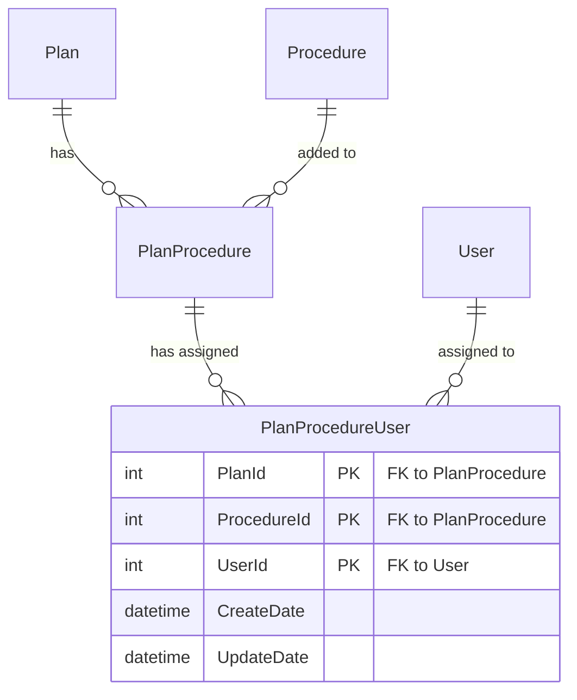

# OEC Interview - Fullstack React / .NET

The objective of this assignment is to test your knowledge on some key technologies we use. 

## How to prepare?

To start, read the [Installation.md](Installation.md). This will give you all the required downloads you will need to run the interview question.

## Start

To use docker to develop, run the following command from this folder:
```
docker-compose up -d --build
```

- Frontend will load on url `http://localhost:3001`
- Backend will load on url `http://localhost:10010`

## Additional Information

For information outline the existing backend table structure, take a look at [DataModel.PNG](DataModel.PNG) in this folder

More information about the migrations: [migrations.md](./Interview/RL.Data/migrations.md)

# The Task

## Introduction

We have provided a working example of a website that can create a vehicle repair plan by adding individual repair procedures to an initial blank plan. The application displays a list of available procedures, and the user can decide and select those that he deems necessary to repair the vehicle. In addition, we can assign a person or several people to each procedure added to the plan (in this case: a mechanic, an employee of a repair facility, etc.). 

## Issue description / Bug report

Steps to reproduce:

1. Create a new `Plan`
   - This happens when you click `Start` on the home page of the frontend project when it's running.
   - List of procedures available for the plan load are loaded automatically when a plan is created. They will show up in `Procedures` list (left column of the Plan).
1. Add 2 procedures to the `Plan`
   - Procedures are added to a plan when you click a checkbox from the Procedures list on the left side of the plans component.
   - After being added, the procedure checkbox will show up selected along with being added to the Added to Plan list on the right side of plans page
1. Add users to the procedures
   - Select and add 1 User to the first procedure and select and add 2 different Users to the second procedure in the plan
   - User is added to the procedure by selecting it from the "Select User to Assign" drop-down menu below the procedure title.
1.  Refresh the page

Behavior:

- After refreshing the page, the “Select User to Assign” field is empty.

Expected behavior:

- After refreshing the page, the “Select User to Assign” field should display any previously added user.

In addition to the above, implement functionality to:

-  **Remove Users:**
Users assigned to a procedure should be able to be removed by the user from the procedure.
- **Remove All Users:**
Provide functionality to remove all users from a procedure at once.

## Solution notes
1. Create table structure to store the assigned users
2. Create endpoint(s) to interact with new table structure
3. Hook up endpoint(s) to the frontend so when a user is selected, they are correctly assigned to that procedure

# Solution

## What the bug was

The users picked in "Select User to Assign" were only kept in React state inside `PlanProcedureItem`. Nothing was sent to the backend and there was no table to store them in, so a refresh started from an empty selection again.

## What changed

- **Table:** new `PlanProcedureUsers` table (`PlanId`, `ProcedureId`, `UserId` as a composite key) linking a user to a procedure inside a plan. The migration is `AddPlanProcedureUsers` and it is already applied to the committed `Database.db`, because the app does not run migrations on startup.
- **Endpoints**, all on `PlanProcedureController`, each one a MediatR command + handler like `AddProcedureToPlan`:

  | Route | Body | Purpose |
  | --- | --- | --- |
  | `POST /PlanProcedure/AddUserToPlanProcedure` | `planId`, `procedureId`, `userId` | Assign a user to a procedure of a plan |
  | `POST /PlanProcedure/RemoveUserFromPlanProcedure` | `planId`, `procedureId`, `userId` | Remove one user |
  | `POST /PlanProcedure/RemoveAllUsersFromPlanProcedure` | `planId`, `procedureId` | Remove every user from the procedure |

- **Loading:** the existing `GET /PlanProcedure` is reused, the frontend just adds `planProcedureUsers` to `$expand`.
- **Frontend:** `PlanProcedureItem` starts from the saved users and calls the endpoints from the select's `onChange`. The x on a user removes that user, the x on the right of the select removes all of them.
- **Status codes:** `ToActionResult` now returns 404 for a `NotFoundException` (it used to be 400 for every failure). This also applies to the existing `AddProcedureToPlan` endpoint.

## Data model

[DataModel.PNG](DataModel.PNG) shows the tables that were already there. The new `PlanProcedureUser` entity (table `PlanProcedureUsers`) sits between `PlanProcedure` and `User`:



Deleting a plan procedure or a user also deletes its rows in this table (cascade).

## How to run and test

I ran and tested it without docker, in two terminals from the repo folder.

Backend, on `http://localhost:10010`:

```
cd Interview/RL.Backend
dotnet run
```

Frontend, on `http://localhost:3001` (PowerShell shown, on bash use `PORT=3001 npm start`):

```
cd interview-frontend
npm install
$env:PORT=3001; npm start
```

The port matters: the backend only allows requests from `http://localhost:3001`, and without `PORT` the frontend starts on 3000.

The docker setup from the Start section above is not changed (no new packages, no changes to the Dockerfiles or `docker-compose.yml`), but I did not run the solution through docker.

Unit tests:

```
cd Interview
dotnet test
```

## Assumptions

- "Remove all" uses the clear button that the select already has, so no extra button was added.
- The select is only updated after the request succeeds. If a request fails the selection stays as it was, there is no error message shown to the user.
